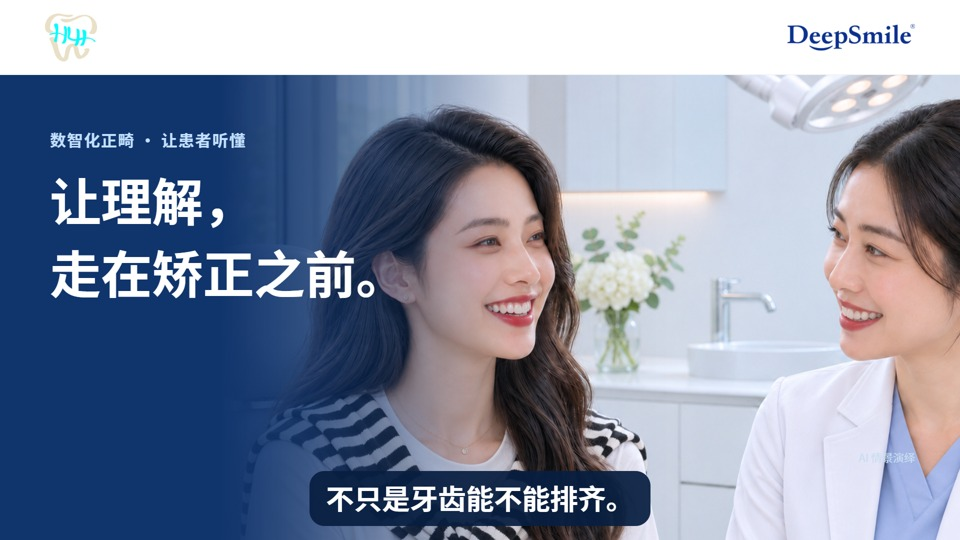

# DeepSmile 门诊品牌视频技能

固定模板：**让理解，走在矫正之前**。基于已确认的贝特瑞尔口腔定稿，保留成熟 React / TypeScript / Remotion 动效。

## 两项输入

门诊全称 + 门诊 Logo（PNG/JPG/WebP）。建议透明或纯白底高清 Logo。Logo 自动裁去外围留白、保留原色与比例；不需提供额外文案。

## 安装与生成

需要 Python 3.10+、Node.js 20.9+、联网和可用 Chrome/Remotion 浏览器。Windows 建议解压至 D 盘。

```sh
python bootstrap.py
python video.py --name "某某口腔" --logo "D:/素材/logo.png" --allow-online-tts
```

Windows 可将 python 换成 `py -3`。在线配音参数表示允许将公开门诊名和固定旁白发送微软语音服务；不上传图片或报告。不添加参数不会发送。

Windows 有 D 盘时默认保存到 D:/门诊品牌视频/；其他环境保存到 outputs/。用 --output 指定路径。成片 `renders/DeepSmile-合作视频-门诊名称.mp4`，1920×1080 /30fps；约一分钟（随门诊名自动适配）。同时保留无 BGM 母版、封面、关键帧、旁白原稿和字幕。`--stills` 只生成关键帧，后续可用 `--resume 项目目录` 完成同一项目。

## 在 AI 助手中调用

下载完整仓库并放入 AI 助手的 skills/deepsmile-clinic-video 目录（SKILL.md 位于根目录），然后说：
“用 DeepSmile 门诊视频模板制作，门诊名称：某某口腔，Logo 见附件；允许将门诊名和公开旁白发送微软语音服务。”

技能必须搭配完整仓库资源；不需要 Microsoft 密钥。Edge 在线服务可用性不保证，失败时保留项目供重试，不擅自更换音色。

## 封装结构

沿用 yayan-video-templates 的 bootstrap.py + video.py + catalog.json + 本地环境检查形式。src 为锁定定稿母版；每次生成独立工作副本。原项目及输入文件不被覆盖。素材使用范围见 ASSETS.md，第三方许可见 licenses/。

## 下载

[完整模板 ZIP](https://github.com/papadou/deepsmile-clinic-video-skill/archive/refs/heads/main.zip) · [技能入口](SKILL.md)



首次配置会从官方 Noto CJK 下载字体、每次项目从 Mixkit 下载配乐；大字体和独立音乐不放入 GitHub。Remotion 使用许可见 THIRD_PARTY_NOTICES.md。
